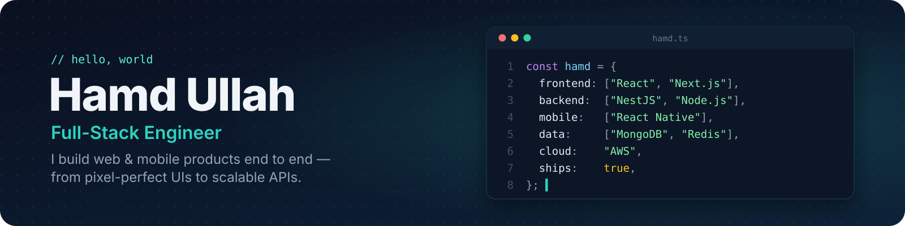

# Hi 👋, I'm Hamd ullah

### Full Stack Web Developer from Pakistan 🇵🇰
### Building modern web apps with React, Next.js & NestJS

---

## 🙋‍♂️ About Me

- 🚀 **Full Stack Web Developer** with hands-on experience building scalable web applications
- ⚡ Specialized in **React, Next.js** on the frontend and **NestJS, Node.js** on the backend
- ☁️ Experienced with **AWS** services including S3, EventBridge, Lambda, and more
- 🌱 Currently learning **GraphQL**
- 💻 All my projects are at [mysite-30254.web.app](https://mysite-30254.web.app/)
- 💬 Ask me about **MERN, Next.js, NestJS and React Native**
- 📫 Reach me at **hamdullahdir98@gmail.com**

---

## 🌐 Connect with Me

---

## 🛠️ Languages & Tools

### Frontend

### Backend & Database

### Tools & Platforms

---

## 📊 GitHub Stats

---

## 🏆 GitHub Trophies

