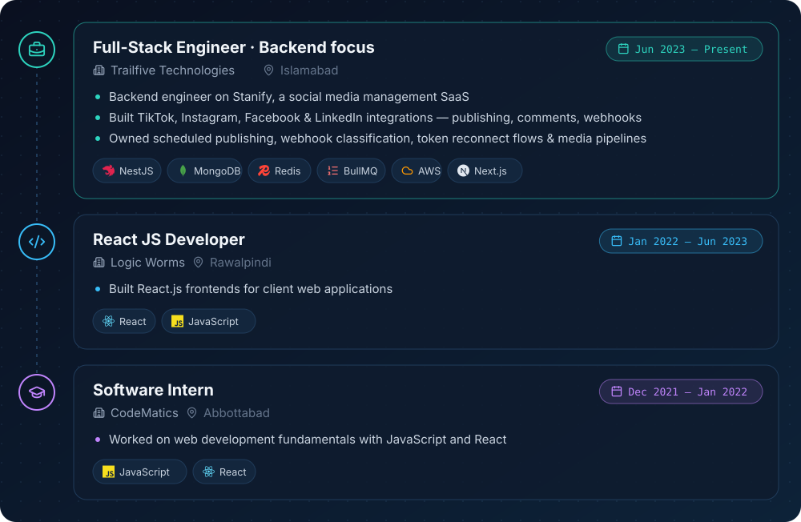
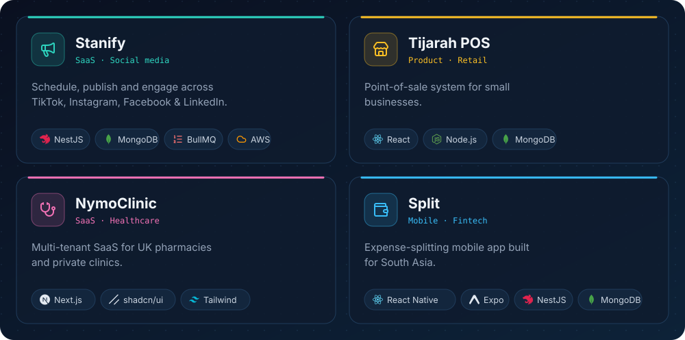

<div align="center">


[](https://git.io/typing-svg)

[](https://linkedin.com/in/hamd-ullah-7747b6218)
[](https://mysite-30254.web.app/)
[](mailto:hamdullahdir98@gmail.com)


</div>

---

## 🧑‍💻 About Me

```ts
class Hamd extends Engineer {
  role       = "Full-Stack Engineer (backend-heavy)";
  company    = "Trailfive Technologies";
  location   = "Islamabad, Pakistan 🇵🇰";
  experience = "4+ years in production";
  education  = "BS Software Engineering, UET Peshawar";

  focus   = ["Scalable APIs", "Third-party integrations", "Queues & jobs"];
  openTo  = ["Remote backend roles", "Full-stack roles"];
  askMeAbout = "NestJS, MongoDB, BullMQ, AWS, React/Next.js";
}
```

- 🔌 Integrated **TikTok, Instagram, Facebook & LinkedIn** APIs end-to-end — OAuth, publishing, webhooks, mentions
- ⚙️ Built queue-driven scheduling with **Redis + BullMQ** (prepare/commit pipelines, retries, rate limits)
- 🎞️ Designed a media validation pipeline with **ffprobe + AWS MediaConvert** to auto-fix non-compliant videos
- 🔐 Shipped workspace-level authorization (guards + access service) across a multi-tenant SaaS

---

## 💼 Experience

<div align="center">
  
</div>

---

## 🚀 Featured Work

<div align="center">
  
</div>

---

## 🧰 Languages & Tools

<div align="center">

[](https://skillicons.dev)

</div>

---

## 🎓 Education

**BS Software Engineering** — *UET Peshawar* &nbsp;`2017 – 2021`

---

## 📊 GitHub Stats

<div align="center">


</div>

---

## 🐍 Contribution Snake

<div align="center">

<picture>
  <source media="(prefers-color-scheme: dark)" srcset="https://raw.githubusercontent.com/hamd311/hamd311/output/github-snake-dark.svg" />
  
</picture>

</div>


